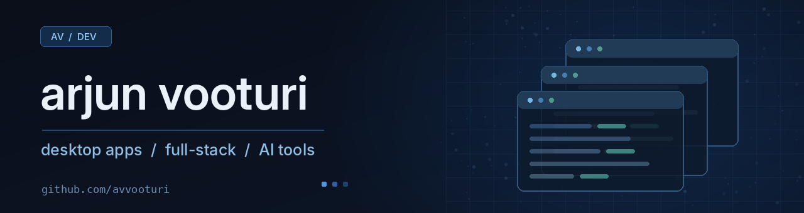

  

  <b>Arjun Vooturi</b> 
  Full-stack development · desktop apps · AI tooling 
  Computer Science, UCF · M.S. Analytics, Georgia Tech

I like building tools I actually use. Lately that's meant working on desktop apps, experimenting with AI integrations, and figuring out how to make the things I build more reliable.

### projects

| project | what it does | built with |
|:--|:--|:--|
| [jarvis](https://github.com/avvooturi/jarvis) | desktop voice assistant with speech recognition, tool routing, and persistent memory | Python, SQLite |
| bible focus | distraction-resistant Bible reading app | Electron, React, TypeScript |
| meeting copilot | meeting notes and contextual assistance | TypeScript |

Bible Focus and Meeting Copilot are personal projects in progress. I'll link them once they're ready to share.

### tools I use

Python · TypeScript · JavaScript · React · Next.js · FastAPI · PostgreSQL · SQLite · Git · Docker
